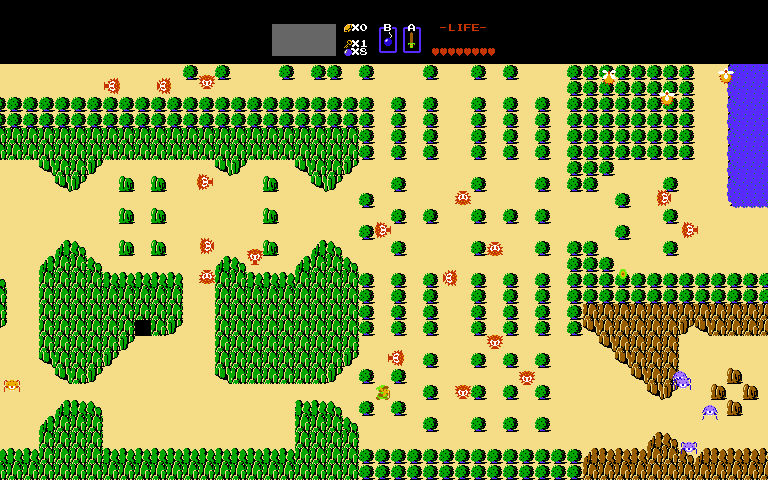
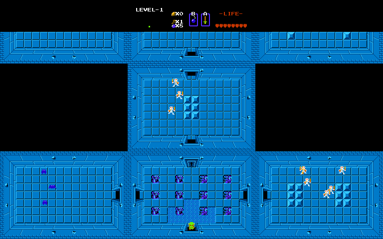
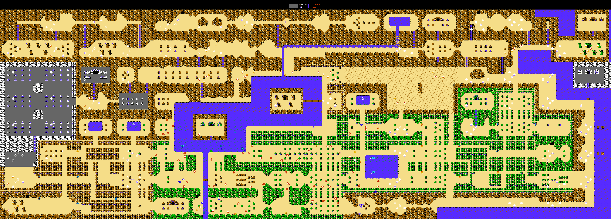
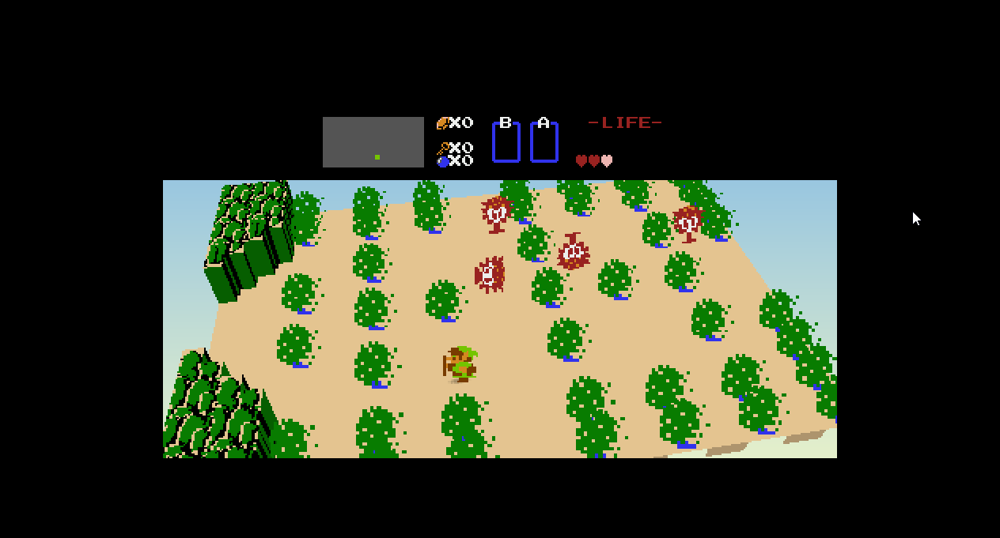

# LegendOfZeldaNESRecomp

> _This recompilation is a **byproduct of developing
> [nesrecomp](https://github.com/mstan/nesrecomp)** — the games are the proving ground, the framework is the goal.
> **These are in-development previews, not finished ports — expect rough
> edges**, and depth will keep landing over months, not days. My time for any
> one title is limited, so I ask for your patience. Contributions are welcome —
> testing, issues, and PRs to the game or framework all help and will
> accelerate this game's polish. More on the why at:
> [Recomp + AI: 5 Months Later »](https://1379.tech/recomp-ai-5-months-later/)_

Static recompilation of The Legend of Zelda (NES) for native PC.
Built with the [NESRecomp](https://github.com/mstan/nesrecomp) framework.

> **Cycle migration preview:** the cycle CPU is now the default source build, with the legacy backend still available. The earlier legacy build was tested through dungeon 7. Current cycle checks cover startup, an overworld route, save/replay and presentation modes; a new full-game audit is pending. See [cycle migration notes](docs/CYCLE-MIGRATION.md).

## Acknowledgments

The complete dispatch function coverage was made possible by the [zelda1-disassembly](https://github.com/aldonunez/zelda1-disassembly) by Aldo Nunez. The disassembly's debug symbols were used to extract callable function addresses for the SRAM-mapped code region, closing the final dispatch gaps.

## What Works

- Overworld exploration, with optional seamless camera and neighboring rooms
- Dungeons, bosses, and items
- Enemies and combat
- Caves (old man, merchants, dungeon entrances)
- Inventory / pause subscreen
- Battery-backed save persistence (`saves/<ROM stem>.sav` beside the executable); older raw 8 KiB `.srm` progress imports through the launcher

## Quick Start

1. Download `LegendOfZeldaNESRecomp-USA-NTSC-cycle-mods-preview-windows-x64.zip` from [Releases](../../releases)
2. Extract and run `LegendOfZeldaNESRecomp.exe`
3. Select your Legend of Zelda (USA) ROM when prompted — the path is saved for future launches

## Seamless Overworld · Experimental

New in **v1.10.0**. Open **Mods** and enable **Seamless Overworld**, the first
entry under **Camera**. Its amber **EXP / EXPERIMENTAL** badge marks it as an
experimental feature. Fresh profiles enable it for adaptive widescreen;
existing explicit mod choices are retained. Its Gameplay options include
Stopwatch scope: Entire map, Current viewport at pickup, or Current room at pickup.

<p align="center">
  
</p>

The camera follows Link across ordinary room boundaries, with neighboring
terrain and actors visible before he enters. Connected dungeon rooms also
share the continuous view. **Fit to screen** expands the visible world to match
the window in landscape or portrait; resize freely, use the **mouse wheel** to
change pixel zoom, or press **F4** to see the whole map.

<p align="center">
  
</p>

Inventory retains the expanded scene, bomb flashes span the view, and death,
Game Over and Continue keep the window's framing. Caves, stairs, dungeon
entrances and maze puzzles preserve their original portal routing. This mode
is mutually exclusive with voxel and Remastered views.

<p align="center">
  <a href="docs/assets/seamless-atlas.png"></a>
</p>

**Experimental limits:** local play only. Enemy migration and projectile
interactions across room boundaries are incomplete, the whole-map simulation
runs slower, and later dungeons, bosses and both quests still need broader
coverage. These are representative gameplay checks, not a full-game completion
claim. See [implementation and validation notes](docs/SEAMLESS-WORLD.md).

## Controls

For silent startup failures, enable **Startup and Crash Diagnostics** in
**Mods** before PLAY, then share the newest log and any matching Windows
minidump from `diagnostics` beside the program. This mod is disabled by default.
See [diagnostic instructions](docs/DIAGNOSTICS.md).

| NES Button | Keyboard |
|------------|----------|
| D-Pad      | Arrow keys |
| A          | Z |
| B          | X |
| Start      | Enter |
| Select     | Backslash |

| Hotkey | Action |
|--------|--------|
| Escape | Menu/settings |
| Tab | Hold fast-forward |
| F7 | Save-state slots |
| F8 | Rewind |
| F11 | Fullscreen |
| F12 | Screenshot |
| Numpad 0 | Toggle Voxel 3D |
| Numpad 8 / 2 | Increase / decrease camera pitch |
| Numpad 4 / 6 | Adjust camera yaw left / right |
| Numpad 7 / 9 | Roll camera left / right |
| Numpad + / - | Zoom in / out |
| Numpad 1 / 3 | Shrink / enlarge assembled sprites |
| Numpad 5 | Reset the live camera rig to package defaults |
| Right stick (first person) | Look horizontally and vertically |
| Left stick / D-pad / arrow keys (first person) | Move relative to the camera |

## Zelda Remastered HD Mod

Use your original USA PRG0 ROM. In the launcher's **Mods** page, enable
**Zelda Remastered HD**, choose **Select file**, and select your original
Zelda Remastered v1.3 ZIP download. The application validates and imports the
artwork and audio itself; no manual extraction or cartridge modification is
needed. The creator's notice is retained in the local import.

HD is disabled by default and shares the presentation exclusion group with
Seamless Overworld and voxel views. **Replacement music and sound** is on by
default within HD; turn it off to retain the original NES soundtrack while
keeping the artwork. Imported audio uses the existing mono output.

This mode preserves original-cartridge gameplay with optional artwork/audio.
It does not implement every gameplay change in the pack's Remastered IPS.
The separate optional **Select B-item cycling** mod cycles owned items.
Disable HD and restart to return to another presentation. Current-build save
states require the same selected assets and mod options.

With Remastered enabled, choose **Graphics → HD resolution** in the in-game
settings. **Pack resolution** keeps the pack's original size; you can also choose
1× through 16×. The 32× and 64× choices are experimental.

## Voxel 3D (experimental)

<p align="center">
  
</p>

Open **Mods** in the launcher and enable either **Voxel 3D Overworld (Experimental)** or
**Voxel 3D First Person (Experimental)**. The two presentation modes are mutually exclusive:
enabling one automatically disables the other. Both bundled features are
disabled by default and target the verified stock PRG0 ROM. Camera
pitch, yaw, roll, zoom, and sprite scale can be saved as package options. The
numpad controls above provide temporary live experimentation; they do not
rewrite `mods/state.toml`. Title, registration, and inventory screens remain
flat and pillarboxed.

The overworld camera presents each room as a raised tabletop. Pitch changes how
far the camera looks down into the room; yaw orbits around the vertical axis;
roll tilts the horizon; zoom changes framing without changing the room; and
sprite scale adjusts assembled Link, enemy, item, and effect cards. Extreme
angles are intentionally available for experimentation, while Numpad 5 returns
the live camera to the package defaults.

The first-person camera follows Link's live position and uses a two-stick
control model: the right stick owns continuous yaw and pitch, while the left
stick moves relative to the direction being viewed. D-pad and arrow-key input
use the same camera-relative mapping. Zelda's original movement remains
four-directional, so diagonal or off-axis intent is quantized to the nearest
native cardinal direction with a small hysteresis band to prevent jitter.
Temporary numpad yaw participates in that same mapping, so pressing forward
continues through the adjusted view instead of snapping the camera elsewhere.
Link's own card is hidden because the camera occupies it, while
enemies, weapons, pickups, effects, terrain, shadows, and the original HUD
remain visible. In this mode pitch looks up or down, yaw offsets the view from
the current heading, and zoom adjusts the field of view.

Geometry comes from Zelda's live 32x22 `PlayAreaTiles` grid and its collision
classification. The original frame supplies tile textures, while current OAM
pieces are assembled into coherent camera-facing metasprite cards before
projection. Zelda's verified 2x2 tree metatiles become transparent,
camera-facing foliage cards; boundary rocks remain solid prisms. Every tree,
actor, pickup, weapon, projectile, and effect card receives a proportional
contact shadow. Native-room clipping and a Link-specific height cap prevent
transition-only OAM pieces from stretching over northern doors. Room scrolling
holds the last complete diorama while Zelda streams its next nametable, then
replaces it atomically with the completed destination room. The black HUD field
is extended across the widescreen frame while the original HUD remains centered
and pixel-perfect. This is a presentation-only trusted plugin: normal execution,
the stock ROM, saves, and launches with the feature disabled are unchanged.

## Building from Source

Requires Visual Studio 2022 and CMake 3.20+.

```bash
git clone https://github.com/mstan/LegendOfZeldaNESRecomp
cd LegendOfZeldaNESRecomp

# Windows
setup.bat

# Linux / macOS
chmod +x setup.sh && ./setup.sh
```

This initializes the pinned [nesrecomp](https://github.com/mstan/nesrecomp)
and recomp-ui submodules. Cycle configuration generates native code directly from your supplied ROM.

Then build:

```bash
cmake -S . -B build-cycle -G "Visual Studio 17 2022" -A x64 -DNESRECOMP_ROM="F:/ROMs/Legend of Zelda.NES"
cmake --build build-cycle --config Release
```

Choose the same USA PRG0 ROM at runtime. Remastered uses the Mods importer above. For an explicit legacy build, see [cycle migration notes](docs/CYCLE-MIGRATION.md).

### Supported cartridge images

`NESRECOMP_ROM` decides which image the build is recompiled from: its PRG
hash, launcher SHA-256 and mod image identity are all derived from that file,
so the executable only accepts that image. `ZELDA_ROM_VARIANT` selects the
recompiler profile under `config/cycle/` — the discovery inputs (game config,
interpreter seed list, RAM captures) used to translate the code:

| Variant | Image | Payload CRC32 |
|---------|-------|---------------|
| `stock` (default) | USA retail, e.g. the dump the profile was captured from | `3fe272fb` |
| `stock` (default) | another USA dump of the same program revision | `c452304e` |
| `relocalized` | SimpleDanny v1.1 translation + Snarfblam "Add" + font mod + Relocalized | `397b56a6` |

The profile describes *how* the code is discovered; the image identity is
always hashed from the file you pass, so several dumps of one title can build
under the same profile. Both USA dumps above were built with `stock`: 8 807
instructions compiled, no unmatched `[[mod_function_hook]]`, and 1 800 frames
in which the native output matches `--interp-only` frame for frame.

```bash
cmake -S . -B build-relocalized -G "Visual Studio 17 2022" -A x64 \
  -DZELDA_ROM_VARIANT=relocalized \
  -DNESRECOMP_ROM="F:/ROMs/Legend of Zelda (Relocalized).nes"
cmake --build build-relocalized --config Release
```

The `relocalized` profile keeps the retail profile's discovery inputs because
the hack changes cartridge data (text, font, tilemaps), not the executable
layout: every `[[mod_function_hook]]` signature, the SRAM-mapped startup copy
and the interpreter seed addresses match the retail image, which the
recompiler reports at configure time (an unmatched hook is a warning, and this
profile builds without one). See [ROM header compatibility](docs/ROM_HEADERS.md).

A MinGW/GCC build stages the compiler's own runtime DLLs (`libstdc++-6.dll`,
`libgcc_s_seh-1.dll`, `libwinpthread-1.dll`) beside the executable, the way the
MSVC build stages the VC runtime; without them the program fails in the loader
with `0xC0000135` on a machine that has no toolchain on `PATH`.

The three experimental packs (Seamless Overworld and both Voxel 3D views)
declare all of the images above, and `zelda_world_supported()` accepts their
payload CRCs: the room decoder runs the image's own routines at `$FFAC`,
`$A8C4` and `$83D7`, which are intact in every listed image. The visual result
on the non-reference images is not yet verified — see
[ROM header compatibility](docs/ROM_HEADERS.md).

### One executable for several images

The images this executable accepts are described by hashes in
`config/cartridges/accepted-images.txt`. Cartridge data is never part of this
repository, so the list cannot be derived from ROM files a given machine happens
to have: every listed image is baked into `cyc_game_image_accepted()`
(`src/cyc_extras.c`) and into the launcher's SHA-256 allowlist, and the mod
catalog follows the loaded image through `nes_mod_runtime_retarget_c()`, so the
packages' `[[target]]` lists decide what serves which image.

`NESRECOMP_ROM` is the image the code is generated from. `ZELDA_EXTRA_ROMS`
(optional, `;` separated paths) lets a local build point at images it has on
disk; an image that is not listed in the manifest is still accepted for that
build, with a warning. To accept a dump permanently, add its
`crc32|fnv1a|sha256|name` line to the manifest.

A secondary image runs on the cycle-accurate interpreter, not on the compiled
blocks: the compiler bakes the ROM bytes it can prove into constants, so blocks
generated from one image do not reproduce another — measured as a per-cycle
trace divergence at identical memory, registers and cycle counts. The
interpreter is exact for any image and still runs this title at roughly 160
frames/s headless, well above the 60 Hz the host paces. Acceptance is therefore
"this executable runs your image", not "the native blocks are image-neutral".


## Architecture

The original 6502 code is translated to cycle-aware C and compiled to native code. Unprofiled code and cartridge work-RAM code safely use the cycle interpreter. The PPU, APU and mapper advance with the guest CPU.

- `config/cycle/` — default cycle configuration, seeds and capture inputs
- `config/legacy/` — retained legacy compiler configuration and disassembly symbols
- `src/` — game integration, presentation, diagnostics and mod plugins
- `assets/` — launcher box art
- `docs/` — controls, release notes, diagnostics and implementation notes; historical discovery evidence is in `docs/reference/`
- `tools/make_release.ps1` (or `tools/release.bat`) — Windows release packaging
- `tools/import_hdpack.py` — shared framework HD-pack package importer with Zelda attribution
- `src/cyc_extras.c` / `src/cycle_bridge.h` — cycle presentation, input and diagnostics adapter
- `src/zelda_voxel.c` — Zelda tile-height profile and 3D view controls
- `build-cycle/cycle-*` — generated cycle code (do not edit manually)
- `generated/` — retained legacy generated inputs
- `nesrecomp/` — framework submodule (recompiler + runner)

## Known Limitations

- Remastered retains sampler limitations for unsupported conditions or missing images. Imported replacement music and effects use mono output; complete Remastered IPS gameplay changes are not claimed.
- Legacy binary save states do not transfer to the cycle backend. Raw battery progress remains portable.
- Voxel views retain their existing experimental camera and geometry limitations.
- Seamless Overworld remains experimental; its current limitations are listed above.

## License

For this project's code covered by the [PolyForm Noncommercial License](LICENSE),
[PERMISSIONS.md](PERMISSIONS.md) grants standing permission for voluntary
donations, sponsorships, and advertising revenue, including support for broader
development initiatives. Payment must not buy access to the software, games
built with it, or their updates, features, or game content, including early access.

Matthew Stanley has authority from the relevant copyright holders to grant
these permissions for the project's PolyForm-covered code. Third-party
components and code explicitly licensed under other terms retain those terms.

PolyForm Noncommercial 1.0.0 — see [`LICENSE`](LICENSE). Third-party
components retain their own licenses.

---

<p align="center">
  <sub><b>R.A.I.D. — Retro AI Development</b> · a Discord for AI-assisted retro reverse-engineering, decomp &amp; recomp</sub>
</p>

<p align="center">
  <a href="https://discord.gg/Ad9BwSzctP"></a>
</p>
